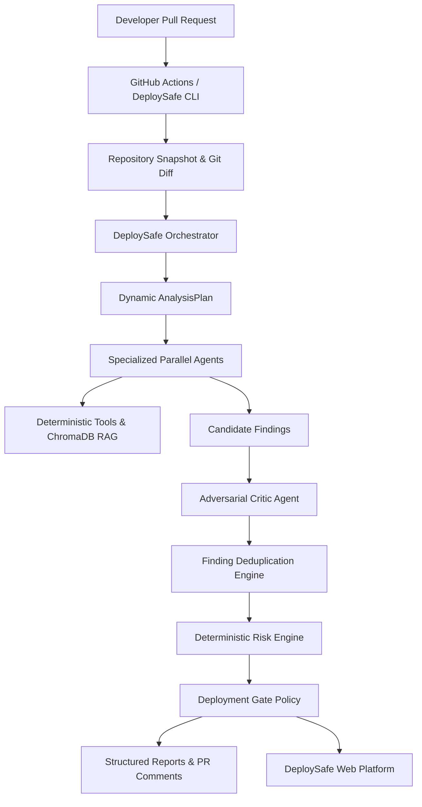

# DeploySafe: Agentic AI Pre-Deployment Risk Platform

> **Know the deployment risk before you deploy.**  
> Built under academic mentorship of **Mr. Naveen Singla** and **Dr. Kiran Khatter**.  
> **Production Release**: v1.0.0 (Phase 6 Final Release)

---

## 1. Overview
DeploySafe is an agentic AI pre-deployment risk platform designed to evaluate software repositories and pull requests before deployment. By uniting specialized AI agents with deterministic scanners, vector retrieval (RAG via ChromaDB), an adversarial reflection Critic, and an explainable mathematical risk engine, DeploySafe detects cross-boundary architectural hazards that traditional CI/CD pipelines fail to catch.

---

## 2. The Problem
Over 65% of catastrophic production deployment outages pass standard CI/CD pipelines. Traditional continuous integration is an **imperative execution runner**: it runs unit tests and linters, but lacks holistic semantic reasoning across software boundaries:
- **Environment Drift**: Code references newly added environment variables omitted from `.env.example`, Dockerfiles, or Kubernetes manifests.
- **Port & Host Inconsistencies**: Microservice bindings drift between code, Docker Compose, and reverse proxy specs.
- **Dependency Vulnerabilities**: Unpinned, floating, or deprecated packages trigger runtime crashes.
- **Security & Privilege Hazards**: Containers running as `root`, exposed secrets in commit history, and unsafe execution routines.

---

## 3. The Solution
DeploySafe inspects the *entire repository holistically* prior to deployment:
- **Correlates Git Diffs**: Analyzes the PR diff against the repository context using RAG.
- **Grounded Verification**: Restricts agents to deterministic tools (`get_file_content`, `docker_check`, etc.) to eliminate hallucinated findings.
- **Adversarial Reflection**: An independent Critic Agent verifies every finding against physical files.
- **Deterministic Risk Scoring**: Computes an authoritative 0–100 score mathematically without LLM intervention.
- **Automated Gating**: Enforces deterministic deployment gates (`ALLOWED`, `REVIEW_REQUIRED`, `BLOCKED`).

---

## 4. Why Agentic AI?
Single-prompt LLM architectures fail on multi-thousand-line codebases due to:
1. **Context Window Saturation**: Critical configuration details get lost in the middle of massive prompts.
2. **Hallucination Cascades**: A single generalist LLM invents non-existent files and imaginary line numbers.
3. **Lack of Specialization**: A single prompt cannot cleanly coordinate AST parsers, vulnerability databases, dockerfile scanners, and test execution harnesses.

DeploySafe divides the analysis problem among specialized domain agents coordinated by an orchestrator.

---

## 5. System Architecture


---

## 6. Multi-Agent Architecture
- **Orchestrator (`DeploySafeAnalysisFlow`)**: Profiles repository file categories, constructs dynamic execution plans, manages thread pool concurrency, and enforces the Phase 6 Partial Failure policy.
- **Code Analysis Agent**: AST error propagation, async leaks, unhandled exceptions.
- **Configuration Analysis Agent**: Environment variables, Dockerfile security, port alignment.
- **Dependency Analysis Agent**: Manifest parsers (`requirements.txt`, `package.json`), unpinned packages, known CVEs.
- **Test Analysis Agent**: Test adequacy, mock consistency, safe test execution.
- **Documentation RAG Agent**: Correlates PR diffs against indexed architectural runbooks.
- **Security Analysis Agent**: Leaked credentials, command injection, path traversal.
- **Critic Agent**: Adversarial verification engine rejecting hallucinated candidates.
- **Report Generation Agent**: Executive summaries, remediation action plans, export generation.

---

## 7. Retrieval-Augmented Generation (RAG)
- **Document Chunking**: 1000-character chunks with 200-character semantic overlap.
- **Vector Embedding**: Google `text-embedding-004` (768 dimensions) with deterministic local fallback for offline environments.
- **ChromaDB**: Isolated vector collections partitioned by `repository_id`.
- **Querying**: Queries vector space using git diff text and modified file paths to retrieve relevant documentation chunks.

---

## 8. Deterministic Tools
DeploySafe equips agents with structured, restricted tools:
- `get_file_content(file_path, line_start, line_end)`: Reads ground-truth source code lines.
- `docker_check(dockerfile_path)`: Scans Dockerfiles for `USER root`, unpinned base images, and missing healthchecks.
- `get_dependency_manifests()`: Returns parsed package specifications.
- `get_git_diff()`: Extracts canonical git diff and changed file names.
- `run_tests_safe()`: Executes pytest/npm test within sandboxed timeouts.

---

## 9. Deterministic Risk Engine
Risk scores are calculated mathematically by `RiskEngine`:
$$\text{Score} = \min\left(100, \text{round}\left(\sum_{f \in \text{Validated}} W(\text{severity}_f) \times C(\text{confidence}_f) \times I(\text{impact}_f)\right)\right)$$

- **Severity Weights**: `CRITICAL` = 35 pts, `HIGH` = 25 pts, `MEDIUM` = 15 pts, `LOW` = 7 pts.
- **Confidence Multipliers**: `HIGH` = 1.0, `MEDIUM` = 0.8, `LOW` = 0.6.
- **Impact Multipliers**: `CRITICAL` = 1.2, `HIGH` = 1.0, `MEDIUM` = 0.8, `LOW` = 0.6.
- **Risk Tiers**: 0–29 `LOW`, 30–59 `MODERATE`, 60–79 `HIGH`, 80–100 `CRITICAL`.
- Rejected, duplicate, or unverified findings contribute **0 points**.

---

## 10. GitHub Actions & CI/CD Gating
DeploySafe integrates directly into CI workflows via `.github/workflows/deploysafe.yml`:
```yaml
- name: Run DeploySafe Pre-Deployment Analysis
  run: |
    python -m backend.app.cli analyze --target . --ci --format markdown --output deploysafe-report.md
```
- **Exit Code 0**: Deployment gate `ALLOWED` (Risk $\le 50$, no Critical findings).
- **Exit Code 1**: Deployment gate `BLOCKED` (Risk $> 50$ or Critical findings present).
- **PR Comments**: Idempotently posts formatted risk breakdowns directly to GitHub Pull Requests.

---

## 11. Security & Safety Guardrails
- **Secret Redaction**: `SecretRedactionEngine` scrubs API keys (Gemini, Groq, GitHub PATs, AWS, RSA keys) before storage or prompt transmission.
- **Prompt Injection Defense**: Untrusted repository content is wrapped in `<untrusted_repository_content>` tags with strict system prompt boundaries.
- **Restricted Command Execution**: Sandboxed tool harness prevents arbitrary command execution.
- **Public Repo Audit**: Zero credentials or `.env` files tracked in git.

---

## 12. Benchmark Evaluation Suite
Automated evaluation against 5 benchmark repositories (`demo-repos/evaluation/`):
- **Issue Detection Rate (Recall)**: **80.0%** (4/5 target cases detected).
- **Evidence Validity**: **100.0%** (all detected findings verified against real code).
- **Average Latency**: **4.34 seconds** per evaluation repository.
- **Agent Failure Rate**: **0.0%**.

---

## 13. Installation

### Prerequisites
- Python 3.11+
- Node.js 18+ and npm
- Git

```bash
# Clone the repository
git clone https://github.com/yashrao2607/NAVEEN-SIR_PROJECT.git
cd NAVEEN-SIR_PROJECT

# Install Python backend dependencies
python -m pip install -r backend/requirements.txt

# Install frontend dependencies
cd frontend
npm install
cd ..
```

---

## 14. Environment Variables
Copy the configuration template:
```bash
cp .env.example .env
```
Key configuration variables (see [ENV_SETUP.md](file:///d:/NAVEEN-SIR_PROJECT/ENV_SETUP.md) for full guide):
- `GEMINI_API_KEY`: Primary LLM and embedding key (from Google AI Studio).
- `GROQ_API_KEY`: Fast fallback LLM provider key (from Groq Cloud).
- `GITHUB_TOKEN`: GitHub Personal Access Token (for PR diffs & comments).
- `PRIMARY_LLM_PROVIDER`: `gemini` (default) or `groq`.
- `FALLBACK_LLM_PROVIDER`: `groq` (default) or `gemini`.

---

## 15. Running Locally

### Backend API Server
```bash
python -m uvicorn backend.app.main:app --host 0.0.0.0 --port 8000 --reload
```
- API live at: `http://localhost:8000`
- Interactive Swagger docs: `http://localhost:8000/docs`
- Health check: `http://localhost:8000/api/v1/health`

### Frontend SPA
```bash
cd frontend
npm run dev
```
- Frontend application live at: `http://localhost:5173`

---

## 16. Running via Docker
Run the complete production stack (Backend + Frontend Nginx proxy + Health checks):
```bash
docker compose up --build
```
- Frontend UI accessible at: `http://localhost:5173` (or `http://localhost:3000`)
- Backend API accessible at: `http://localhost:8000`

---

## 17. GitHub CI Integration Setup
To use DeploySafe in your own GitHub repository:
1. Add `GEMINI_API_KEY` (and optional `GROQ_API_KEY`) to your repository's GitHub Secrets.
2. Copy `.github/workflows/deploysafe.yml` into your repository.
3. Every pull request will automatically trigger pre-deployment risk analysis and comment with safety gating decisions.

---

## 18. Running the Demo & CLI Analysis
Run pre-deployment analysis on the included demo repository:
```bash
# Analyze via CLI
python -m backend.app.cli analyze --target demo-repos/deploysafe-rag-demo --format markdown

# Run with CI exit-code enforcement
python -m backend.app.cli analyze --target demo-repos/deploysafe-rag-demo --ci
```

---

## 19. Testing
Execute the complete test suite:
```bash
# Run all 92 pytest backend tests
$env:PYTHONPATH="."; pytest backend/tests/ -v

# Run frontend production build & TypeScript check
npm --prefix frontend run build
```

---

## 20. Known Limitations
1. **Static Scope**: Evaluates static code, configs, Dockerfiles, and package manifests; does not execute live fuzzing against dynamic staging clusters.
2. **Language Optimization**: Deep AST parsing is optimized for Python, JS/TS, Dockerfile, JSON, and YAML.
3. **Repository Boundaries**: Ingestion is bounded at 2,000 files and 200MB to maintain low-latency analysis.

---

## 21. Future Work
- Ephemeral sandbox execution and live cluster fuzzing.
- Native AST parsers for Rust, Go, and Java.
- Automated Pull Request auto-remediation (Report Agent generating suggested PR fix branches).

---

## Academic Documentation Links
- [Technical Viva Defense Guide (24 Q&As)](file:///d:/NAVEEN-SIR_PROJECT/docs/viva-guide.md)
- [Final Live Classroom Demo Script (27 Steps)](file:///d:/NAVEEN-SIR_PROJECT/docs/final-demo-script.md)
- [Team Contribution Matrix](file:///d:/NAVEEN-SIR_PROJECT/docs/contribution-matrix.md)
- [Final Presentation Outline (19 Slides)](file:///d:/NAVEEN-SIR_PROJECT/docs/final-presentation.md)
- [Release Notes v1.0.0](file:///d:/NAVEEN-SIR_PROJECT/RELEASE_NOTES.md)
- [System Architecture](file:///d:/NAVEEN-SIR_PROJECT/docs/architecture.md)
- [Phase 6 Completion Report](file:///d:/NAVEEN-SIR_PROJECT/PHASE6DONE.md)
