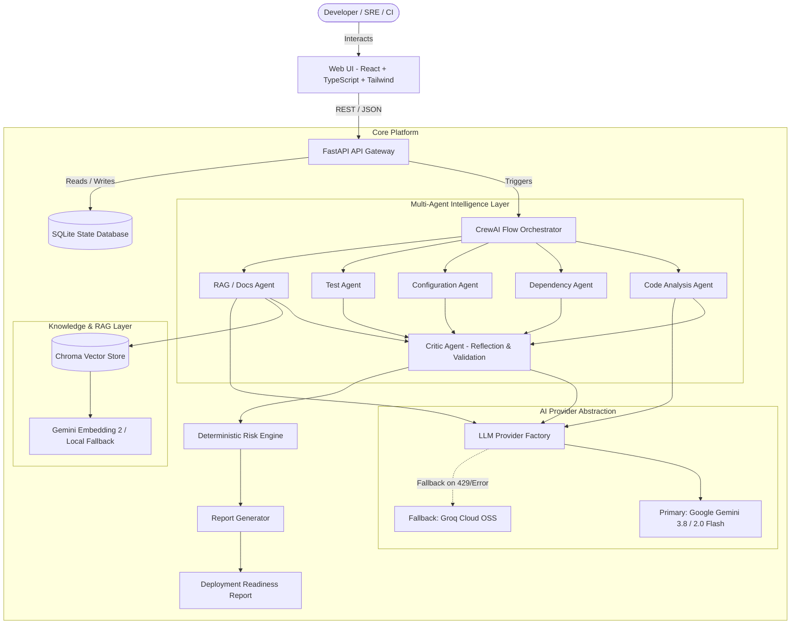
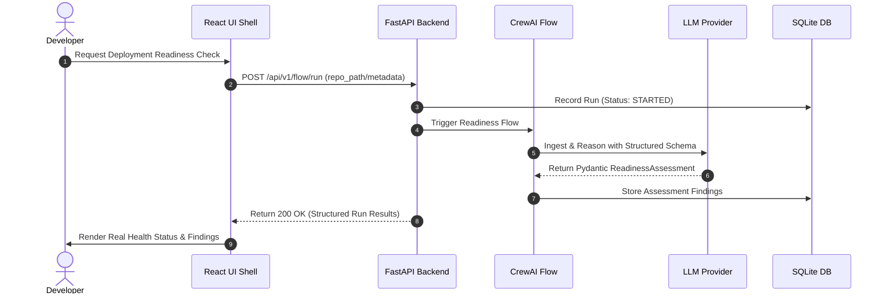
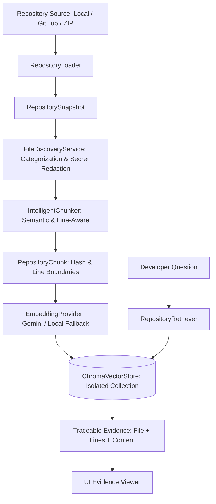
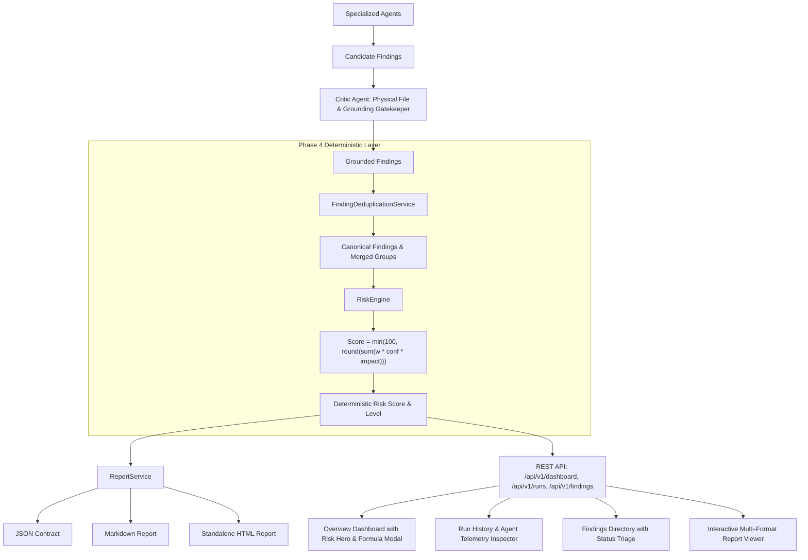

# DeploySafe — System Architecture & Design Specification

> **Source of Truth:** Derived directly from [`prd.md`](file:///d:/NAVEEN-SIR_PROJECT/prd.md) (§7, §8, §9, §10, §30, §37).

---

## 1. High-Level System Architecture

DeploySafe decouples deterministic fact-finding from agentic reasoning and evidence-backed synthesis.



---

## 2. Core Architectural Principles (`prd.md` §9 & §37)

1. **Deterministic Tools Find Facts:** Linters, security scanners, manifest parsers, and test runners provide ground-truth observations.
2. **Agents Interpret Facts:** CrewAI agents reason over facts, identify operational interactions, and assess deployment impact.
3. **RAG Provides Repository Context:** The Chroma vector store grounds agent reasoning in project-specific documentation (e.g. `README.md`, architecture guidelines, runbooks).
4. **Critic Validates Findings:** A dedicated Critic agent cross-checks every finding against evidence, filtering out hallucinations and duplicates.
5. **Risk Engine Calculates Scores Deterministically:** Scores are never arbitrarily generated by LLMs; they follow mathematical weighting:
   $$\text{Score} = \sum (\text{Severity Weight} \times \text{Confidence} \times \text{Scope})$$

---

## 3. Data Flow Specification



---

## 4. Repository Structure (`prd.md` §30)

```text
deploysafe/
├── backend/
│   ├── app/
│   │   ├── api/v1/         # Versioned API routes (health, runs, findings)
│   │   ├── core/           # Configuration, structured logging, database
│   │   ├── models/         # Pydantic schemas & SQLAlchemy ORM models
│   │   ├── services/llm/   # LLMProvider abstraction (Gemini + Groq)
│   │   └── agents/         # CrewAI flows and agent definitions
│   ├── tests/              # Pytest backend & agent test suite
│   └── requirements.txt    # Python dependencies
├── frontend/
│   ├── src/
│   │   ├── components/     # UI components (shell, cards, tables, status)
│   │   ├── pages/          # Dashboard, Runs, Findings, Agents, Settings
│   │   ├── lib/            # API client and utilities
│   │   └── index.css       # Tailwind design system
│   ├── package.json
│   └── vite.config.ts
├── docs/                   # Product & technical specifications
├── scripts/                # Development & terminal monitoring utilities
├── .env.example            # Environment configuration template
├── .env                    # Local environment variables (ignored by git)
├── .gitignore              # Version control ignore rules
├── ENV_SETUP.md            # Step-by-step key acquisition instructions
└── README.md               # Main project README
```

---

## 5. Security & Secret Safeguards (`prd.md` §25, §36)

- **Zero Client-Side Credentials:** API keys (`GEMINI_API_KEY`, `GROQ_API_KEY`, `GITHUB_TOKEN`) are strictly consumed in the backend.
- **Log Masking:** The structured logging pipeline intercepts all log statements and redacts strings matching API key patterns (`AIza...`, `gsk_...`, `ghp_...`).
- **Git Protection:** `.gitignore` enforces exclusion of `.env`, `.env.*.local`, `.venv`, and temporary artifacts.

---

## 6. Phase 2: RAG & Vector Storage Foundation



### Components Implemented in Phase 2
1. **RepositoryLoader:** Ingests local directory snapshots, shallow-clones GitHub repositories, and safely extracts ZIP archives with Zip-Slip path traversal defense.
2. **FileDiscoveryService:** Discovers and categorizes files into 8 domains (`SOURCE_CODE`, `TEST`, `CONFIG`, `DOCUMENTATION`, `DOCKER`, `CI_CD`, `SCRIPT`, `OTHER`), applying ignore rules and redacting secrets (`***REDACTED_SECRET***`).
3. **IntelligentChunker:** Creates deterministic chunks (`chk_...`) along class, function, markdown heading, and docker instruction boundaries, recording exact starting and ending line numbers.
4. **EmbeddingProvider:** Implements Gemini `text-embedding-004` (768 dimensions) and a deterministic fallback `LocalEmbeddingProvider` (384 dimensions) with stop-word filtering.
5. **ChromaVectorStore:** Enforces strict repository isolation with query filtering (`where={"repository_id": ...}`) and persistence in `CHROMA_PATH`.
6. **RepositoryRetriever:** Evaluates relevance thresholds (`FOUND`, `LOW_RELEVANCE`, `NOT_FOUND`), preventing hallucinated responses.
7. **REST Endpoints:** Mounted at `/api/v1/repositories/*` for ingestion, indexing status, semantic search, and file discovery.

---

## 7. Phase 3: Core Multi-Agent Intelligence Layer

```mermaid
graph TD
    Repo[Ingested Repository Snapshot] --> Flow[DeploySafeAnalysisFlow]
    Flow --> Ctx[Analysis Context Builder]
    Ctx --> Plan[Orchestrator Planning]
    
    subgraph Parallel Analysis Execution
        Plan --> CodeAgent[Code Analysis Agent]
        Plan --> DepAgent[Dependency Agent]
        Plan --> ConfigAgent[Configuration Agent]
        Plan --> TestAgent[Test Agent]
        Plan --> RAGAgent[Documentation / RAG Agent]
        Plan --> SecAgent[Security Analysis Agent]
    end
    
    subgraph Tool Layer & Sandbox
        CodeAgent & ConfigAgent --> RepoTools[RepositoryTools: Line Slicing & Diff]
        DepAgent --> ManifestTools[Manifest Parsers]
        TestAgent --> SafeExec[SafeCommandExecutor: Sandboxed Pytest]
        RAGAgent --> ChromaStore[(Chroma Vector Store)]
        SecAgent --> Scanners[Bandit & Secret Redaction Scanner]
    end
    
    CodeAgent & DepAgent & ConfigAgent & TestAgent & RAGAgent & SecAgent --> Aggregator[Finding Aggregator]
    Aggregator --> Critic[Critic Agent: Ground Truth Gatekeeper]
    
    Critic -->|Physical File Check| DiskCheck{File Exists on Disk?}
    DiskCheck -- Yes --> GroundCheck{Evidence Substantial?}
    DiskCheck -- No --> Reject[Status: REJECTED]
    GroundCheck -- Yes --> DupCheck{Duplicate Check}
    GroundCheck -- No --> LowEv[Status: INSUFFICIENT_EVIDENCE]
    DupCheck -- Unique --> Valid[Status: VALIDATED]
    DupCheck -- Redundant --> Merged[Status: DUPLICATE]
    
    Valid & Merged & Reject & LowEv --> ReportAgent[Report Synthesis Agent]
    ReportAgent --> FinalReport[Structured Analysis Report]
    FinalReport --> RESTAPI[/api/v1/analysis/*]
    RESTAPI --> WebUI[React Analysis Dashboard & Evidence Viewer]
```

### Key Components Implemented in Phase 3
1. **`DeploySafeAnalysisFlow`:** Orchestrates context preparation, dynamic planning based on repository technologies, parallel agent execution, Critic gatekeeping, and report compilation.
2. **Specialized Agents:** 6 domain-specific agents (`CodeAnalysisAgent`, `DependencyAnalysisAgent`, `ConfigurationAnalysisAgent`, `TestAnalysisAgent`, `DocumentationRAGAgent`, `SecurityAnalysisAgent`) operating under prompt-injection isolation boundaries.
3. **`CriticAgent`:** Adversarial reflection gatekeeper verifying physical file presence, line ranges, and merging duplicates.
4. **Typed Tool Layer:** Sandboxed command execution with strict binary allowlists, path traversal defenses, secret redaction, and semantic retrieval.
5. **Real-Time Telemetry:** Tracks per-agent duration, tools called, finding counts, and flow execution states.
6. **Web Dashboard:** Interactive repository analysis interface with live agent timeline, severity metrics, filterable findings table, and line-accurate code evidence viewer.

---

## 7. Phase 4 Architecture: Deterministic Risk Engine & Product UI



### Phase 4 Architectural Guarantees
1. **Non-LLM Scoring:** The Risk Engine calculates scores through pure, reproducible mathematics. LLMs never emit the final deployment risk number.
2. **Deduplication Identity:** Identifies overlapping line ranges and matching scanner rules across agents, consolidating duplicates while preserving attribution.
3. **Auditability:** Complete itemization of contributors (+pts) and exclusions with justifications (e.g. DUPLICATE, DISMISSED).
4. **Multi-Format Exportability:** Deterministic reports ready for pipeline gates (JSON), documentation (Markdown), and human audit (standalone styled HTML).


