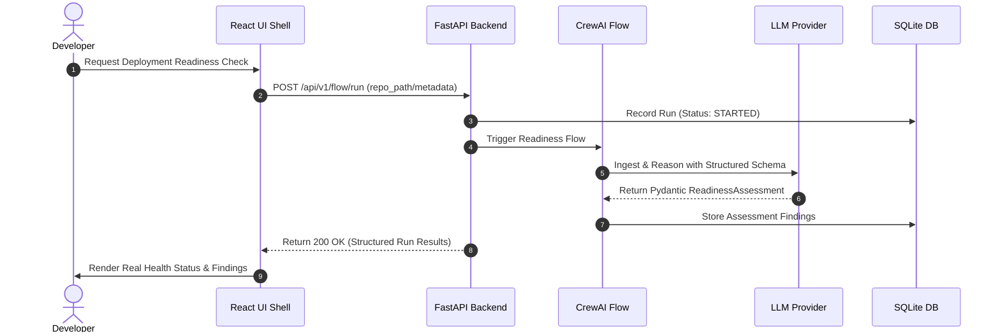

# DeploySafe — System Architecture & Design Specification

> **Source of Truth:** Derived directly from [`prd.md`](file:///d:/NAVEEN-SIR_PROJECT/prd.md) (§7, §8, §9, §10, §30, §37).

---

## 1. High-Level System Architecture

DeploySafe decouples deterministic fact-finding from agentic reasoning and evidence-backed synthesis.


---

## 2. Core Architectural Principles (`prd.md` §9 & §37)

1. **Deterministic Tools Find Facts:** Linters, security scanners, manifest parsers, and test runners provide ground-truth observations.
2. **Agents Interpret Facts:** CrewAI agents reason over facts, identify operational interactions, and assess deployment impact.
3. **RAG Provides Repository Context:** The Chroma vector store grounds agent reasoning in project-specific documentation (e.g. `README.md`, architecture guidelines, runbooks).
4. **Critic Validates Findings:** A dedicated Critic agent cross-checks every finding against evidence, filtering out hallucinations and duplicates.
5. **Risk Engine Calculates Scores Deterministically:** Scores are never arbitrarily generated by LLMs; they follow mathematical weighting:
   $$\text{Score} = \sum (\text{Severity Weight} \times \text{Confidence} \times \text{Scope})$$

---

## 3. Data Flow Specification



---

## 4. Repository Structure (`prd.md` §30)

```text
deploysafe/
├── backend/
│   ├── app/
│   │   ├── api/v1/         # Versioned API routes (health, runs, findings)
│   │   ├── core/           # Configuration, structured logging, database
│   │   ├── models/         # Pydantic schemas & SQLAlchemy ORM models
│   │   ├── services/llm/   # LLMProvider abstraction (Gemini + Groq)
│   │   └── agents/         # CrewAI flows and agent definitions
│   ├── tests/              # Pytest backend & agent test suite
│   └── requirements.txt    # Python dependencies
├── frontend/
│   ├── src/
│   │   ├── components/     # UI components (shell, cards, tables, status)
│   │   ├── pages/          # Dashboard, Runs, Findings, Agents, Settings
│   │   ├── lib/            # API client and utilities
│   │   └── index.css       # Tailwind design system
│   ├── package.json
│   └── vite.config.ts
├── docs/                   # Product & technical specifications
├── scripts/                # Development & terminal monitoring utilities
├── .env.example            # Environment configuration template
├── .env                    # Local environment variables (ignored by git)
├── .gitignore              # Version control ignore rules
├── ENV_SETUP.md            # Step-by-step key acquisition instructions
└── README.md               # Main project README
```

---

## 5. Security & Secret Safeguards (`prd.md` §25, §36)

- **Zero Client-Side Credentials:** API keys (`GEMINI_API_KEY`, `GROQ_API_KEY`, `GITHUB_TOKEN`) are strictly consumed in the backend.
- **Log Masking:** The structured logging pipeline intercepts all log statements and redacts strings matching API key patterns (`AIza...`, `gsk_...`, `ghp_...`).
- **Git Protection:** `.gitignore` enforces exclusion of `.env`, `.env.*.local`, `.venv`, and temporary artifacts.
