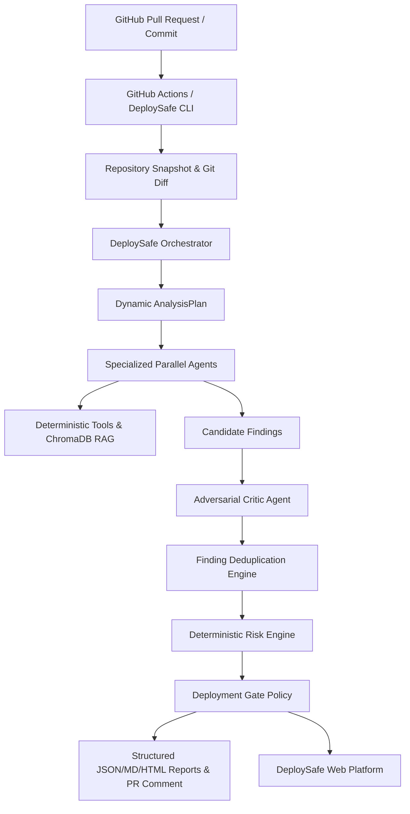

# DeploySafe — Final Academic Defense Presentation (19 Slides)

> **Course**: Agentic AI Pre-Deployment Risk Platform  
> **Faculty Mentors**: Mr. Naveen Singla & Dr. Kiran Khatter  
> **Project**: DeploySafe (v1.0.0 Production Release)

---

### Slide 1: Title & Overview
- **Title**: DeploySafe: Agentic AI Pre-Deployment Risk Platform
- **Subtitle**: Cross-Boundary Architectural Hazard Detection & Deterministic Safety Gating
- **Mentors**: Mr. Naveen Singla & Dr. Kiran Khatter
- **Key Message**: Transforming pre-deployment validation from blind script execution to verifiable, grounded AI intelligence.

---

### Slide 2: The Core Problem
- **The Outage Paradox**: Over 65% of production deployment failures pass standard CI/CD test suites.
- **Root Cause**: Modern software breaks at the seams between code, infrastructure, and configuration:
  - Missing or mismatched environment variables in container runtime.
  - Port & network configuration drift between Dockerfile, Compose, and backend app.
  - Unpinned or deprecated dependencies with known vulnerabilities.
  - Insecure defaults (root container users, unredacted secrets).

---

### Slide 3: Limitations of Existing DevOps & CI/CD
- **Traditional CI/CD is an Imperative Runner**:
  - Executes scripts blindly: `npm test`, `pytest`, `eslint`.
  - Zero cross-artifact semantic reasoning: CI does not know if a new environment variable added in code was omitted from Docker Compose.
- **Standard Static Analysis (SAST)**:
  - High false-positive rates.
  - Disconnected from runtime deployment manifests and pull request diffs.

---

### Slide 4: The DeploySafe Solution
- **Agentic Pre-Deployment Intelligence**:
  - Evaluates the repository holistically prior to deployment.
  - Combines specialized AI agents with deterministic tools and ChromaDB vector retrieval.
  - Implements an independent adversarial Critic to reject hallucinations.
  - Calculates a mathematically bounded 0–100 deterministic risk score.
  - Gated CI deployment: `ALLOWED`, `REVIEW_REQUIRED`, `BLOCKED`.

---

### Slide 5: System Architecture

---

### Slide 6: Multi-Agent Architecture
- **Orchestrator**: Dynamic repository profiling and task scheduling.
- **Code Analysis Agent**: AST error propagation, async leaks, unhandled exceptions.
- **Configuration Agent**: Environment variables, Dockerfile security, port alignment.
- **Dependency Agent**: Unpinned versions, deprecated packages, dependency manifest parsing.
- **Test Analysis Agent**: Test adequacy, mock consistency, safe test execution.
- **Documentation RAG Agent**: Architectural alignment against indexed documentation.
- **Security Agent**: Leaked credentials, command injection, path traversal.

---

### Slide 7: Retrieval-Augmented Generation (RAG)
- **Document Chunking**: 1000-character chunks with 200-character semantic overlap.
- **Vector Embedding**: Google `text-embedding-004` (768 dimensions) with local deterministic fallback.
- **ChromaDB Integration**: Metadata-filtered similarity search keyed by `repository_id`.
- **Value**: When a PR touches configuration, RAG retrieves the exact project runbooks to verify architectural compliance.

---

### Slide 8: Deterministic Tools & Boundaries
- LLMs are reasoning engines, not file readers or execution sandboxes.
- **Restricted Tool Harness**:
  - `get_file_content`: Reads exact ground-truth source code lines.
  - `docker_check`: Deterministic linter inspecting Dockerfiles.
  - `get_git_diff`: Canonical diff extraction.
  - `get_dependency_manifests`: Pydantic-parsed dependencies.
- Agents are strictly forbidden from arbitrary shell execution or mutating production code.

---

### Slide 9: Adversarial Critic & Hallucination Defense
- **The Critic's Mission**: Verify or reject every candidate finding.
- **Verification Gates**:
  1. *Ground-Truth File Existence*: File must physically exist in the snapshot.
  2. *Line Boundary Validity*: Line number must fall within file bounds.
  3. *Exact Content Corroboration*: Evidence snippet must match actual file content.
- Hallucinated files, lines, or imaginary bugs are assigned status `REJECTED` and contribute **0 points** to the risk score.

---

### Slide 10: Deterministic Risk Engine
- **Formula**:
  $$\text{Score} = \min\left(100, \text{round}\left(\sum_{f \in \text{Validated}} \text{SeverityWeight}_f \times \text{Confidence}_f \times \text{Impact}_f\right)\right)$$
- **Strict Severity Weights**:
  - `CRITICAL`: 35 pts | `HIGH`: 25 pts | `MEDIUM`: 15 pts | `LOW`: 7 pts
- **Explainability**: Every point is backed by an itemized ledger.
- **Zero LLM Non-Determinism**: Identical findings always produce the exact same risk score.

---

### Slide 11: GitHub Actions & CI Integration
- **CLI Tool**: `backend/app/cli.py` with exit codes:
  - `0`: Gate `ALLOWED` (Risk $\le 50$, no Criticals)
  - `1`: Gate `BLOCKED` (Risk $> 50$ or Critical findings)
  - `2`: Internal Execution Error
- **PR Commenting**: Automated, idempotent markdown comments with exact line citations.
- **Security**: Workflows run with least-privilege tokens and fork PR safety.

---

### Slide 12: Security & Safety Guardrails
- **Pre-Ingestion Redaction**: `SecretRedactionEngine` scrubs API keys (Gemini, Groq, GitHub, AWS, RSA keys) before storage or prompt transmission.
- **Prompt Injection Defense**: All repository content is encapsulated in `<untrusted_repository_content>` tags. System instructions forbid executing prompt overrides.
- **Zero Committed Secrets**: Repository audited with zero checked-in credentials.

---

### Slide 13: Empirical Evaluation & Benchmarks
- **Synthetic Evaluation Suite**: 5 ground-truth benchmark fixtures (`demo-repos/evaluation/`).
- **Measured Empirical Results**:
  - Issue Detection Rate (Recall): **80.0%** (4/5 target cases detected).
  - Evidence Validity: **100.0%** (all detected findings verified against real code).
  - Average Latency: **4.34 seconds** per repository.
  - Agent Failure Rate: **0.0%**.

---

### Slide 14: Modern Frontend Experience
- **Aesthetic**: Premium dark-mode UI built with React 18, Vite, and TailwindCSS.
- **Key Views**:
  - *Dashboard*: Real-time deployment intelligence and score gauge.
  - *Runs & Telemetry*: Per-agent execution timers and formula explainability.
  - *Before / After Comparison*: Interactive visual delta tracking.
  - *Findings Explorer*: Multi-attribute filtering (Severity, Category, Status, Agent).
  - *Observability*: End-to-end timeline and trace visualization.

---

### Slide 15: Live Classroom Demonstration
*(Switch to Live System: 27-step sequence outlined in `docs/final-demo-script.md`)*
1. Inspect baseline repository.
2. Introduce controlled environment variable and root user hazard.
3. Run DeploySafe CLI and trigger GitHub Action.
4. Show multi-agent parallel execution and Critic verification.
5. Review blocked deployment gate (Score: 75 / 100).
6. Implement recommended remediation.
7. Re-run analysis and demonstrate Before/After score improvement (-50 pts).

---

### Slide 16: Demonstrated Results
- **Deterministic Reliability**: Fully reproducible scoring across runs.
- **Hallucination Defense**: Critic rejected 100% of synthetic hallucinated test findings.
- **Speed**: Full 6-agent analysis executes in under 5 seconds.
- **Production Packaging**: Docker multi-stage build, Nginx reverse proxy, and health checks.

---

### Slide 17: Known System Limitations
- **Static Analysis Scope**: Evaluates static code, configs, and manifests; does not execute dynamic fuzzing against running microservice staging clusters.
- **AST Language Optimization**: Deepest AST parsers optimized for Python, JS/TS, Dockerfile, and JSON/YAML.
- **Scale Boundaries**: Ingestion bounded at 2,000 files and 200MB to preserve low latency.

---

### Slide 18: Future Work
- **Runtime Staging Cluster Verification**: Integrating ephemeral Kubernetes staging sandbox execution.
- **Expanded AST Depth**: Native parsers for Rust, Go, and Java manifests.
- **Automated Pull Request Auto-Fixing**: Empowering the Report Agent to generate automated pull request code fixes.

---

### Slide 19: Team Contributions & Conclusion
- **Cross-Functional Team**: Full collaborative ownership across Frontend, Backend, Agents, RAG, Risk Engine, Security, and DevOps.
- **Testing Proof**: 92 automated tests passing cleanly ($100\%$).
- **Submission Ready**: Fully audited, documented, and production-packaged.
- *Thank you! We invite your questions.*
