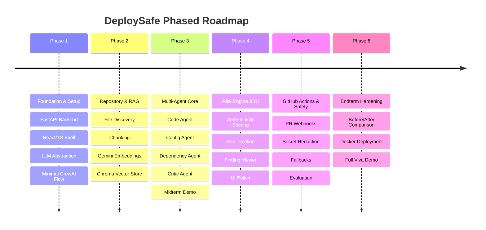

# DeploySafe — Product Scope & Specifications

> **Product Tagline:** *Know the deployment risk before you deploy.*  
> **Source of Truth:** Derived directly from [`prd.md`](file:///d:/NAVEEN-SIR_PROJECT/prd.md).

---

## 1. Executive Definition
**DeploySafe** is a multi-agent AI deployment-readiness intelligence platform. It analyzes software repositories and proposed code changes, fuses deterministic checks (security, dependencies, configuration, tests) with multi-agent LLM reasoning and repository Retrieval-Augmented Generation (RAG), and produces an explainable, evidence-backed deployment-risk report.

---

## 2. Problem Statement
Prior to deploying code to production, software engineering teams must review numerous interconnected areas:
- Source code alterations and breaking changes
- Added, upgraded, or deprecated dependencies and licensing
- Environment variables and configuration drift (`.env`, YAML, JSON)
- Secrets exposure
- Test coverage and regressions
- Docker container specifications and CI/CD pipelines
- Discrepancies between code changes and repository documentation

Standard CI/CD pipelines are deterministic runners: they execute static linters or pre-written test suites, but cannot reason about the *interaction risks* between configuration, architecture, and code modifications. DeploySafe adds an intelligent reasoning layer answering:
1. *What changed across the system?*
2. *What deployment or runtime risks does this change introduce?*
3. *What concrete repository evidence proves that risk?*
4. *What specific, actionable fix should the developer apply?*

---

## 3. Target User Personas

### Persona A: Software Developer
* **Need:** "I modified code across multiple modules. Are there hidden configuration or breaking deployment risks before I merge this Pull Request?"
* **Experience:** Clear findings with precise file paths, line ranges, and actionable remediation steps.

### Persona B: DevOps / SRE / CI Engineer
* **Need:** "Can our team integrate an AI-powered deployment risk verification gate into our GitHub Actions pipeline that blocks high-risk releases without false alarms?"
* **Experience:** Automated PR checks, standardized JSON findings, and customizable risk thresholds.

### Persona C: Academic Professor / Evaluator
* **Need:** "Demonstrate genuine multi-agent orchestration, tool usage, repository RAG, evidence grounding, reflection, and clear architectural separation."
* **Experience:** Observable execution traces, documented design decisions, and verifiable test suites.

---

## 4. Product Goals & Non-Goals

### Product Goals
1. **Detect Meaningful Deployment Risks:** Surface real operational, configuration, dependency, and code risks.
2. **Explain Why Risks Exist:** Provide clear rationale and impact assessments for every finding.
3. **Ground in Repository Evidence:** Every finding must cite exact file paths and line ranges; never hallucinate citations.
4. **Suggest Actionable Fixes:** Provide code or configuration diffs that remediate findings.
5. **Demonstrate Agentic AI:** Utilize specialized, cooperating CrewAI agents rather than a single monolithic prompt.
6. **Integrate with GitHub:** Support automated triggers on PRs and commits.
7. **Deliver Modern UX:** Provide a polished developer-security platform interface with real-time status.

### Non-Goals (Out of Scope)
* **NOT** a replacement for Kubernetes or container orchestrators.
* **NOT** a full CI/CD platform (it inspects and guides, it does not replace GitHub Actions/ArgoCD).
* **NOT** an autonomous code-mutation bot that blindly applies patches to production without human review.
* **NOT** an absolute guarantee of 100% bug-free software.

---

## 5. Phased Delivery Boundaries

### Midterm Target (Phases 1–3)
- Ingest repository (local or GitHub URL)
- Index codebase with RAG
- Orchestrate 4–6 specialized CrewAI agents with tools
- Return structured findings with repository evidence
- Compute preliminary deterministic risk score in a functional UI

### Endterm Target (Phases 4–6)
- Full GitHub Actions PR automation
- Critic agent validation and deduplication
- Deterministic risk engine (Critical/High/Medium/Low)
- Before/after risk score comparison upon push
- Dockerized deployment and comprehensive evaluation suite
